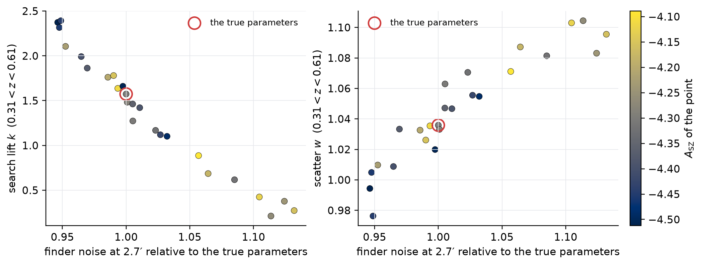
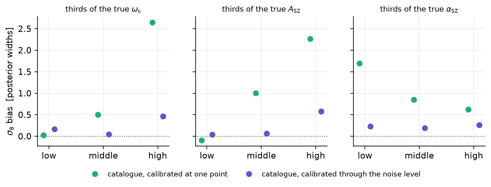

# Calibration

Can the catalogue model be fixed by calibrating it on map-level simulations? This page builds three
calibrated versions, each a file that `survey.catalogue_model` reads (`mapsim calibrate`).

## The calibrated observation model

With the finder's own noise $\sigma_\mathrm{finder}(\theta)$ in place of the instrument-plus-CMB noise, and
per redshift bin $b$ a scale $s$, a search lift $k$, a scatter $w$ and a loss rate $f$:

$$
q = \frac{y_0}{\sigma_\mathrm{finder}(\theta_{500})},\qquad
q_\mathrm{obs} = \begin{cases} \text{lost} & \text{with probability } f_b,\\
\sqrt{(s_b\,q)^2 + k_b} + w_b\,\mathcal N(0,1) & \text{otherwise.} \end{cases}
$$

The published model is $s = 1$, $k = 0$, $w = 1$, $f = 0$ with $\sigma_{y_0}$ in place of
$\sigma_\mathrm{finder}$.

## Fitting it: a censored likelihood

A halo counts as detected if a kept, confirmed peak is matched to it with $q_\mathrm{obs} > 4$ (the finder's
threshold), and as censored otherwise. On every halo with $q > 2$:

$$
\ln\mathcal L(s,k,w,f) = \sum_\text{detected}\left[\ln(1-f) + \ln\frac{1}{w}\,\phi\!\left(\frac{q_\mathrm{obs} - \mu}{w}\right)\right]
+ \sum_\text{not detected}\ln\!\left[f + (1-f)\,\Phi\!\left(\frac{4 - \mu}{w}\right)\right],\qquad \mu = \sqrt{(s q)^2 + k},
$$

with $\phi$ and $\Phi$ the standard normal density and distribution function (`calibration.censored_fit`).
Without $f$, the few bright halos lost to a heavier neighbour would read as huge downward fluctuations and
inflate $w$: on synthetic data, losing 1% of halos at random moves the fitted $k$ from 1.9 to −3.2 and
$w$ from 1.0 to 2.0.

## Calibrated at one point

Fitted on 20 mocks at the true parameters (`mapsim calibrate point`):

| Redshift | $s$ | $k$ | $w$ | $f$ |
|---|---|---|---|---|
| 0.01–0.31 | 0.991 | 1.32 | 1.035 | 2.9% |
| 0.31–0.61 | 0.989 | 1.51 | 1.043 | 1.3% |
| 0.61–0.90 | 0.988 | 1.50 | 1.079 | 0.6% |
| 0.90–1.20 | 0.991 | 1.29 | 1.132 | 0.3% |
| 1.20–1.50 | 0.990 | 1.07 | 1.177 | 0.2% |
| > 1.50 | 1.002 | 0.07 | 1.317 | 0.0% |

Losses are highest at low redshift, where clusters are large and overlap; the scatter grows with redshift,
where they are compact. At the true parameters this model reproduces the mocks' counts to 1–4% per bin and
removes most of the bias ([Results](results.md)). Across the prior it does not: its 90% intervals contain
the true $\sigma_8$ for only 65% of the skies.

## Across the prior

The finder's noise, lift, scatter and losses all depend on how much tSZ the sky holds, which the parameters
set. `mapsim calibrate grid` measures the calibration at the true point and a Latin hypercube of 24 points
over the flat box (5 mocks each), keeping the halo tables for later refits.

<figure markdown="span">
  
  <figcaption>The calibration at the 25 points (the true parameters, circled, and a Latin hypercube of 24 over
  the flat prior), in the redshift bin 0.31–0.61: the search lift k (left) and the scatter w (right), each
  fitted on 5 map-level mocks, against the finder's noise at 2.7′ (the eighth of the 15 filter sizes)
  relative to its value at the true parameters. Colour: the point's A_SZ.</figcaption>
</figure>

The finder's noise moves by −5% to +13% across the prior: more tSZ on the sky (higher $A_\mathrm{SZ}$,
yellow, or higher $\omega_c$ and $\sigma_8$) means more confusion noise. As the noise rises, the search lift
falls from 2.4 to 0.2 and the scatter grows from 0.98 to 1.10: a noisier map makes each faint cluster's own
fluctuations matter less, and the confusion adds scatter. Both follow the noise level more closely than any
single parameter; points with very different $A_\mathrm{SZ}$ lie on the same curve. A calibration made at the
circled point is wrong everywhere else. Two ways to interpolate:

**Linear in the parameters** (`calibrated-theta`, `fit_theta`). With $\boldsymbol x = (\boldsymbol\theta -
\boldsymbol\theta_\mathrm{fid})/\Delta\boldsymbol\theta$ over $(\sigma_8, \omega_c, A_\mathrm{SZ},
\alpha_\mathrm{SZ})$,

$$
\ln\sigma_\mathrm{finder}(\theta_j;\boldsymbol\theta) = \ln\sigma_\mathrm{finder}(\theta_j;\boldsymbol\theta_\mathrm{fid}) + d_j + \boldsymbol g_j\cdot\boldsymbol x,
\qquad c_b(\boldsymbol\theta) = c_{b,0} + \boldsymbol c_b\cdot\boldsymbol x,\quad c\in\{s,k,w,f\}.
$$

**Through the finder's noise level** (`calibrated-noise`, `fit_noise_level`). Every part of the calibration
follows one number closely, the noise level
$u = \ln[\sigma_\mathrm{finder}(2.7';\boldsymbol\theta)/\sigma_\mathrm{finder}(2.7';\boldsymbol\theta_\mathrm{fid})]$,
at the eighth of the 15 filter sizes (2.74′):

$$
u(\boldsymbol\theta) = \sum_m a_m\,\phi_m(\boldsymbol x),\ \ \phi \in \{1, x_i, x_i x_j\};\qquad
\ln\sigma_\mathrm{finder}(\theta_j) = \ln\sigma_\mathrm{finder}(\theta_j;\boldsymbol\theta_\mathrm{fid}) + d_j + e_j\,u;\qquad
c_b = c_{b,0} + c_{b,1}u + c_{b,2}u^2.
$$

Leave-one-out errors over the 25 points:

| Quantity | linear in the parameters | through the noise level |
|---|---|---|
| noise level $u$ | 2.0% | 0.5% (quadratic) |
| noise at the other 14 sizes, given $u$ | | ≤ 0.2% |
| search lift $k$, per redshift bin | 0.14–0.34 | 0.09–0.26 |

Through the noise level, the catalogue model's coverage over the prior matches the map-level posterior's
for $\sigma_8$, $\omega_c$ and $A_\mathrm{SZ}$ (90%, 89%, 88% at the 90% level). It does not for
$\alpha_\mathrm{SZ}$ (78%, and a bias of about +0.6 widths), even when the calibration is also split by
cluster size (`--size`).

<figure markdown="span">
  
  <figcaption>The bias of σ8 (posterior mean minus truth, in posterior σ) on 500 map-level skies drawn from
  the prior, averaged in thirds of each sky's true ω_c, A_SZ and α_SZ, for the catalogue model calibrated at
  one point (green) and through the noise level (violet). 10% of the sky.</figcaption>
</figure>

Calibrated at one point, the model is right near that point (the middle third) and increasingly wrong away
from it: where the true $\omega_c$ or $A_\mathrm{SZ}$ is high, the sky holds more faint-cluster tSZ than the
calibration assumed, the real noise is higher, and the posterior reads the missing bright clusters as a
higher $\sigma_8$, by up to +2.6 widths. A lower slope $\alpha_\mathrm{SZ}$ also means more faint-cluster
signal, hence the opposite trend. Through the noise level the calibration follows these changes and the
trends mostly disappear; what remains is below 0.6 widths.

## What a per-cluster model cannot carry

The remaining slope bias comes from the shape of the finder's errors. For bright clusters ($q > 10$), the
residual $r = (q_\mathrm{obs} - \mu)/w$ exceeds +2.5 for 1.2–1.7% of them, against 0.62% for a Gaussian, and
more so where the sky holds more tSZ: other halos' signal falls by chance onto a cluster and only ever adds.
The residuals' skewness, +1.1 on average, grows with $\omega_c$ and $A_\mathrm{SZ}$. A Gaussian scatter
cannot carry this upward tail; a single exponential tail fits individual clusters better but predicts the
counts worse, because the tail's shape changes with $q$. Carrying it in a catalogue model means emulating
the finder's full error distribution as a function of $q$ and of the amount of tSZ, which is what the
map-level simulations do directly.

## Cost

| Step | Hardware | Time |
|---|---|---|
| Halo table of 20 mocks (41 tiles) | 1 GPU | about 1 min after compilation |
| Fits per redshift bin | CPU | 1–8 min (scipy Nelder–Mead on up to 1 million halos) |
| 25-point grid, 5 mocks each | 1 GPU | about 7 min including the fits (15 min with size cells) |
| Fits through the noise level or linear in θ | CPU | seconds |
