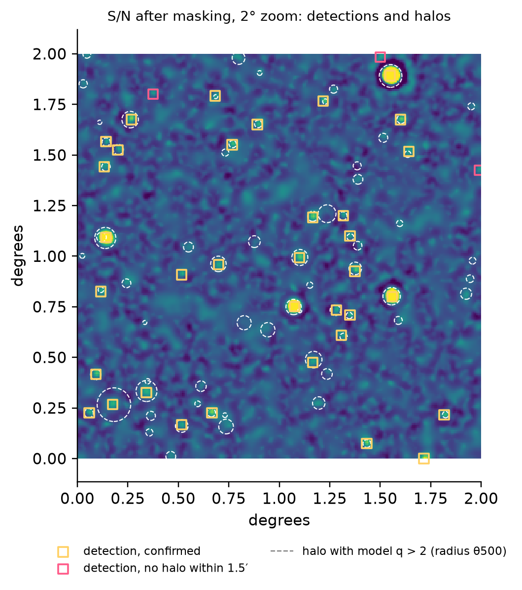
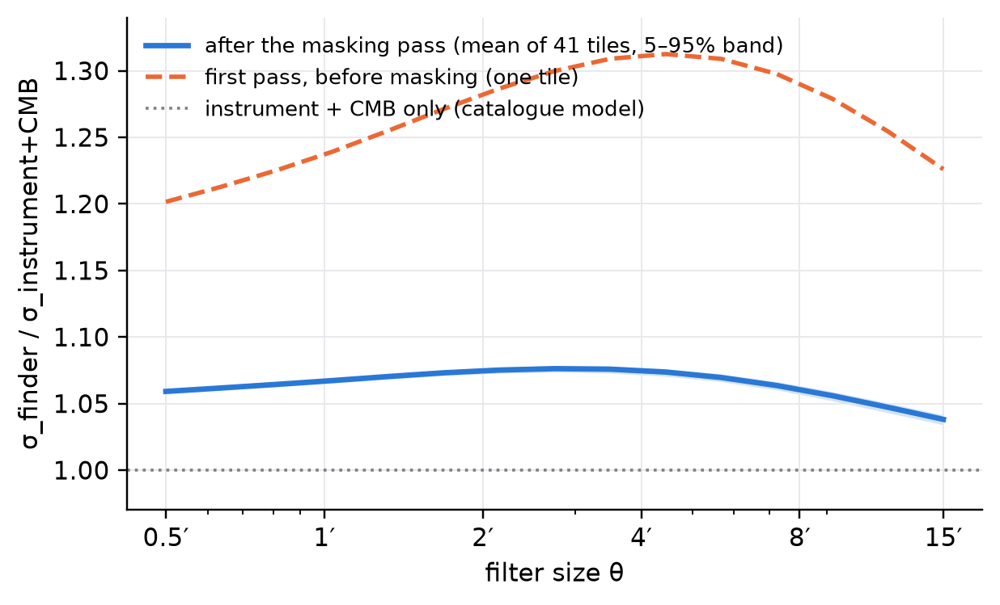
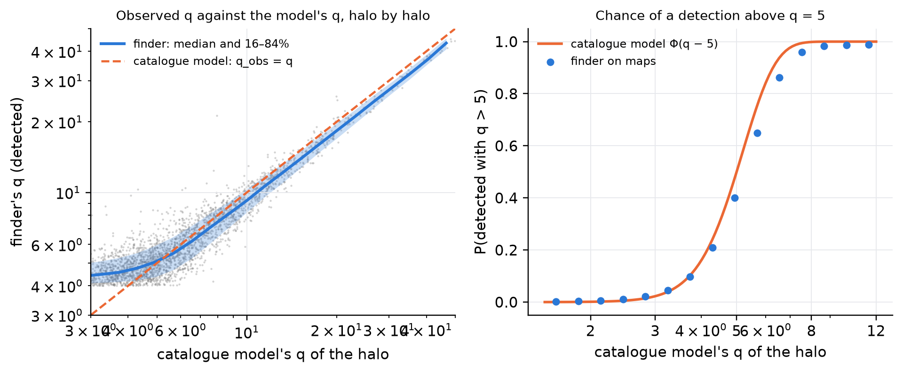
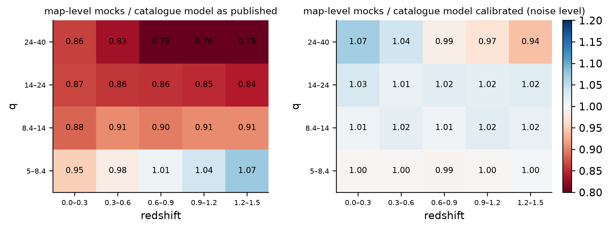

# The finder

The cluster finder is a multi-frequency matched filter (Melin et al. 2006; as in SZiFi), written in JAX so
that it runs on a GPU inside the simulator (`classy_szlite.sim.mmf`, `summaries`).

## The matched filter

With $a_i(\ell) = f_i B_i(\ell)$ the cluster's spectral and beam response in channel $i$, $C(\ell)$ the
6 × 6 covariance of everything that is not the cluster, estimated from the maps themselves in annuli of
$\ell$, and the template of size $\theta$, $\tau_\theta(\ell) = \theta^2 T(\ell\theta)$, the filter
estimates the central $y$ of a cluster centred on every pixel, and its noise:

$$
\hat y_0(\boldsymbol x; \theta) = \sigma_\theta^2 \int \frac{\mathrm d^2\ell}{(2\pi)^2}\,
\tau_\theta(\ell)\, \boldsymbol a(\ell)^{\!\top} C(\ell)^{-1} \boldsymbol X(\boldsymbol\ell)\, e^{i\boldsymbol\ell\cdot\boldsymbol x},
\qquad
\sigma_\theta^{-2} = \int \frac{\mathrm d^2\ell}{(2\pi)^2}\, \tau_\theta(\ell)^2\, \boldsymbol a(\ell)^{\!\top} C(\ell)^{-1} \boldsymbol a(\ell),
$$

$$
q(\boldsymbol x; \theta_j) = \hat y_0(\boldsymbol x; \theta_j)/\sigma_{\theta_j},\qquad
\theta_j \in \{0.5', \dots, 15'\}\ \text{(15 sizes, log-spaced)}.
$$

## Peaks, masking, confirmation

1. **Peaks.** A detection is a maximum of $q$ in position and size: above its four neighbouring pixels and
   its neighbouring sizes, with $q > 4$.
2. **Masking pass.** The first covariance includes the clusters' own signal, which raises
   $\sigma_\theta$ and lowers $q$. Every peak with $q > 4$ is masked with a disc of radius $3\theta_j$, the
   covariance is estimated again outside the discs (after whitening each mode with the first estimate, so
   the disc edges do not leak low-$\ell$ power), and the filter runs once more, as in SZiFi.
3. **Merging.** A peak closer than 1.5′ to a higher one is dropped.
4. **Confirmation.** A peak is confirmed if a halo above $5\times10^{13}\,M_\odot$ lies within 1.5′ (the one
   with the largest $y_0$), and takes that halo's redshift. This stands in for optical follow-up.

<figure markdown="span">
  { width="600" }
  <figcaption>A 2° × 2° zoom of the tile on the previous page: the finder's signal-to-noise after masking
  (colour, −3 to 10), its kept peaks with q > 4 (squares: yellow when confirmed by a halo within 1.5′, pink
  otherwise) and the halos above 5 × 10¹³ M☉ whose catalogue-model q exceeds 2 (dashed circles of radius
  θ500).</figcaption>
</figure>

Most bright spots carry a yellow square inside a circle: a cluster that the finder detects and confirms. Many
circles have no square: halos whose catalogue-model $q$ is between 2 and about 5, which the finder misses or
finds below threshold, as the catalogue model also expects. A pink square is a detection with no massive
halo within 1.5′: a noise peak, or the blend of lower-mass halos below the confirmation mass. Squares sit at
the pixel and size where $q$ peaks, often slightly off the halo's centre: the search over positions and sizes
that lifts faint clusters.

## How the finder's q differs from the catalogue model's

To compare the two halo by halo, `calibration.halo_table` reruns map-level mocks and records, for every
halo above $5\times10^{13}\,M_\odot$, the catalogue model's $q$ (from the analytic noise), the same with
the finder's own noise, and the $q$ of the finder's confirmed peak on that halo. On 20 mocks of the
41-tile survey (3.6 million halos), three differences stand out.

**1. Confusion noise.**

<figure markdown="span">
  { width="620" }
  <figcaption>The finder's noise σ_θ divided by the noise of the instrument and the CMB alone (the
  catalogue model's), at each of the filter's 15 sizes, at the true parameters. Dashed: the first pass, one
  tile. Solid: after the masking pass, the mean of 41 tiles (5 mocks each) with the 5–95% range over tiles
  as a band.</figcaption>
</figure>

The catalogue model assumes the dotted line: a cluster's signal-to-noise set by the instrument and the CMB.
The finder estimates its noise from the maps, which also contain the tSZ of every other cluster. Before
masking, the bright clusters raise it by 20–30%, most on 2–8′ scales, the size of typical clusters. Masking
removes them, but the tSZ of the many clusters too faint to mask remains: confusion noise, 4–8% above the
catalogue model's noise at every size. Every cluster's $q$ is lower by that much. The band is narrow because
with the forecast noise all tiles have the same noise spectrum; the remaining spread comes from the tSZ.

| Filter size | 0.5′ | 1′ | 2′ | 4′ | 8′ | 15′ |
|---|---|---|---|---|---|---|
| $\sigma_\mathrm{finder}/\sigma_\mathrm{instrument+CMB}$, first pass | 1.19 | 1.22 | 1.26 | 1.28 | 1.27 | 1.20 |
| the same, after masking | 1.06 | 1.07 | 1.08 | 1.07 | 1.06 | 1.04 |

**2. Search lift.** Maximising over positions and sizes picks the upward noise fluctuations near each
faint cluster, which acts like $q \to \sqrt{q^2 + k}$ with $k \approx 1.4$ (2.1 for isolated clusters).

**3. Neighbours.** Nearby clusters widen the scatter to about 1.09, and about 1% of halos lose their
match to a heavier neighbour within 1.5′ (3% at $z < 0.3$).

<figure markdown="span">
  
  <figcaption>Left: for halos detected with q > 4 (grey dots: 2,500 drawn at random from the detected halos of
  5 mocks at the true parameters), the finder's q against the catalogue model's q of the same halo; blue: the median and the
  16–84% range in bins of the model's q; dashed: the catalogue model's mean. Right: the fraction of halos
  detected and confirmed with q > 5, against the model's q (blue), and the catalogue model's prediction
  Φ(q − 5) (orange).</figcaption>
</figure>

**Left.** Above $q \approx 6$ the median lies about 8% below the diagonal: the confusion noise of panel 1.
The scatter around it is close to the unit scatter the model assumes, a little wider (about 1.09) because of
neighbours. **Right.** For faint halos ($q$ between 3 and 5) the finder detects more than the model's
$\Phi(q-5)$: its search over positions and sizes picks the upward noise fluctuations near each faint cluster.
For brighter halos it detects fewer, because of the higher noise. Both effects change the counts near the
threshold, where most clusters are.

Fitted over all halos with $q > 2$ (the censored likelihood of [Calibration](calibration.md)):

| Against | scale $s$ | lift $k$ | scatter $w$ | lost $f$ |
|---|---|---|---|---|
| the catalogue model's $q$ (instrument + CMB noise) | 0.921 | 1.39 | 1.09 | 1.0% |
| the finder's own noise | 0.990 | 1.37 | 1.09 | 1.0% |
| the finder's own noise, isolated halos | 0.982 | 2.04 | 0.95 | 0.04% |
| the catalogue model as published | 1 | 0 | 1 | 0 |

Against the finder's own noise the scale is 0.99, so the 8% drop is almost all confusion noise.

## Consequence for the counts

<figure markdown="span">
  
  <figcaption>The 20 counts of the data vector: mean of 100 map-level mocks at the true parameters divided by
  the mean of 100 catalogue-level simulations of the same survey, for the published model (left) and the
  model calibrated through the noise level (right). Rows: bins of q; columns: bins of redshift. Blue: the
  mocks have more clusters; red: fewer.</figcaption>
</figure>

At the true parameters, the map-level mocks have 9–25% fewer clusters above $q = 8.4$ than the published
catalogue model predicts, and up to 7% more faint ones at high redshift. Calibrated through the noise
level, the model comes within 0–4% in most bins, but the brightest bin still differs by up to 7%; what
remains is the subject of [Calibration](calibration.md#what-a-per-cluster-model-cannot-carry).
