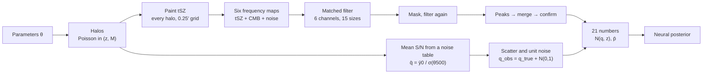
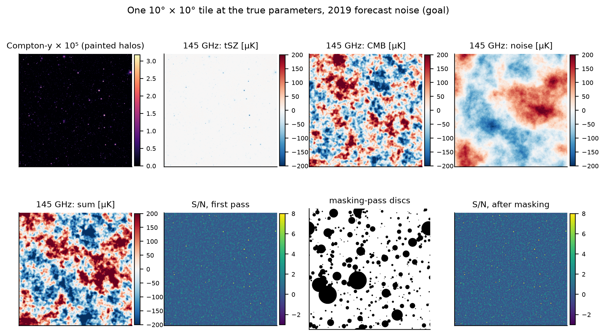

# Forward models

Two forward models of the same survey start from the same parameters and the same halos and end in the
same 21 numbers. They differ in how a halo becomes a detection.

The upper path is the map-level simulator (`classy_szlite.sim.simulator`); the lower one is the
catalogue model of the paper (`classy_szlite.sim.catalogue`).

## The survey and the prior

The survey is a set of flat, periodic 10° × 10° tiles of 1200 × 1200 pixels of 0.5′: 41 tiles (about
10% of the sky, $f_\mathrm{sky} = 0.0994$) or 168 (40.7%). Each tile has the six channels of SO's Large
Aperture Telescope (27, 39, 93, 145, 225 and 280 GHz, beams of 7.4′ to 0.9′).

| Parameter | Prior | True value of the mocks | Role |
|---|---|---|---|
| $\sigma_8$ | U(0.770, 0.852) | 0.811 | amplitude of matter fluctuations |
| $\omega_c = \Omega_c h^2$ | U(0.0804, 0.169) | 0.121 | cold dark matter density |
| $A_\mathrm{SZ}$ | U(−4.53, −4.08) | −4.3054 | log amplitude of the y–M relation |
| $\alpha_\mathrm{SZ}$ | U(1.00, 1.24) | 1.1233 | slope of the y–M relation |
| $h$ | N(0.674, 0.01) | 0.674 | Hubble parameter |
| $\omega_b$ | N(0.0222, 0.00015) | 0.0222 | baryon density |
| $n_s$ | N(0.96, 0.0042) | 0.96 | spectral index |
| $\sigma_\mathrm{SZ}$ | N(0.173, 0.05), > 0 | 0.173 | log-normal scatter of y at fixed mass |
| $\beta_\mathrm{lens}$ | N(0.92, 0.01) | 0.92 | lensing-mass bias |
| $\sigma_\mathrm{lens}$ | N(0.22, 0.05), > 0 | 0.22 | log-normal scatter of the lensing signal |

The flat box (`priors.MAP`) is narrower than the paper's Table 1 (`priors.PAPER`), so that the heaviest
corner stays affordable: about 130,000 halos per tile there, against 73,000 at the true values. The
hydrostatic mass bias is fixed, $1-b = 0.8$. $\Omega_m$ and $S_8 = \sigma_8\sqrt{\Omega_m/0.3}$ are
derived.

## The map-level simulator

### Halos

Halos are drawn in cells of redshift and mass ($0.01 < z < 3$ in 300 bins, $10^{13}$ to
$10^{16}\,M_\odot$ in 150 logarithmic bins) as a Poisson number per cell, with mean

$$
\lambda_c = \Omega_\mathrm{tile} \int_c \mathrm{d}z\, \mathrm{d}\ln M_{500}\;
\frac{\mathrm{d}V}{\mathrm{d}z\,\mathrm{d}\Omega}\, \frac{\mathrm{d}n}{\mathrm{d}\ln M_{500}}(M_{500}, z),
$$

the Tinker et al. (2008) mass function at 500 times the critical density, bilinear between the cell
corners. Each halo is drawn exactly from that bilinear density, at a uniform random position. Every halo
takes its random numbers from a key folded with its cell and its index in the cell, so a change in one
cell's count moves only that cell's halos.

### The tSZ signal

Each halo gets a central Compton-y and an angular size from the paper's scaling relation,

$$
\bar y_0 = 10^{A_\mathrm{SZ}}\, E(z)^2 \left[\frac{h_{70}\,(1-b)\,M_{500}}{3\times 10^{14}\,M_\odot}\right]^{\alpha_\mathrm{SZ}} h_{70}^{-1/2},
\qquad y_0 = \bar y_0\, e^{\sigma_\mathrm{SZ}\, g},\quad g \sim \mathcal N(0,1),
$$

$$
\theta_{500} = 6.997'\; h_{70}^{-2/3} \left[\frac{(1-b)\,M_{500}}{3\times 10^{14}\,M_\odot}\right]^{1/3} E(z)^{-2/3}\, \frac{500\ \mathrm{Mpc}}{D_A(z)},
$$

and the pressure profile of Arnaud et al. (2010), truncated at $5R_{500}$, projected and normalised to 1
at the centre. With $T(u)$ the Fourier transform of the projected shape, the y map of a tile is

$$
y(\boldsymbol\ell) = \sum_h y_{0,h}\, \theta_{500,h}^2\, T(\ell\,\theta_{500,h})\, e^{-i\boldsymbol\ell\cdot\boldsymbol x_h},
$$

painted on a 0.25′ grid and band-limited to the 0.5′ grid (halos larger than 6′ are synthesised directly
in Fourier space).

### Six frequency maps

$$
X_i(\boldsymbol\ell) = f_i\, B_i(\ell)\, y(\boldsymbol\ell) + B_i(\ell)\, T_\mathrm{CMB}(\boldsymbol\ell) + n_i(\boldsymbol\ell),
\qquad f_i = T_\mathrm{CMB}\left[x_i \coth\frac{x_i}{2} - 4\right],\quad x_i = \frac{h\nu_i}{k_B T_\mathrm{CMB}},
$$

with Gaussian beams $B_i$, a Gaussian lensed CMB (the package's CMB emulator at its Planck 2018 point),
and Gaussian noise $n_i$ with the 6 × 6 covariance of the 2019 SO forecast (Ade et al. 2019), goal depth:

$$
N_{ij}(\ell) = \delta_{ij}\, N^\mathrm{white}_i + \rho_{ij}\sqrt{N^\mathrm{red}_i N^\mathrm{red}_j}\left(\frac{\ell}{1000}\right)^{-3.5},
$$

where $\rho_{ij}$ is 1 on the diagonal, 0.9 between the two bands of an optics tube and 0 otherwise.

| Frequency [GHz] | 27 | 39 | 93 | 145 | 225 | 280 |
|---|---|---|---|---|---|---|
| Beam FWHM [′] | 7.4 | 5.1 | 2.2 | 1.4 | 1.0 | 0.9 |
| White noise, goal [μK-arcmin] | 52 | 27 | 5.8 | 6.3 | 15 | 37 |

### The finder and the data vector

The matched filter, its masking pass and confirmation are on [the next page](finder.md). Both inferences
use the paper's 21 numbers: the counts of confirmed detections in bins of $q$ and $z$,

$$
N_{ab} = \#\{\text{detections}: q_a < q < q_{a+1},\ z_b < z < z_{b+1}\},\qquad
q_a \in \{5, 8.4, 14.1, 23.8, 40\},\ z_b \in \{0.01, 0.31, 0.61, 0.90, 1.20, 1.50\},
$$

and the mean CMB-lensing signal $\hat p$ of all confirmed detections with $q > 5$. For each detection's
halo, at the lensing mass $M_\mathrm{lens} = \beta_\mathrm{lens} M_{500}$ (an NFW profile with $c = 3$
truncated at $5R_{500}$),

$$
\bar p = \frac{\kappa(r_s)}{\sigma_\kappa(\theta_{500,\mathrm{lens}})},\qquad
\kappa(r_s) = 4\pi \frac{G}{c^2}\, S\,\rho_0 r_s\, D_A(z)\left(1 - \frac{\chi(z)}{\chi_*}\right),\qquad
p = \bar p\, e^{\sigma_\mathrm{lens} g'} + \mathcal N(0,1),
$$

with $S \simeq 0.663$ and $\sigma_\kappa$ SO's lensing-noise table at goal depth. The lensing signal is
drawn per detected halo, the same way in both inferences.

### One tile, stage by stage

<figure markdown="span">
  
  <figcaption>One 10° × 10° tile at the true parameters, forecast noise. Top: the painted Compton-y map
  (×10⁵), then the 145 GHz map's three parts on a common ±200 μK scale: tSZ, lensed CMB, noise. Bottom: their
  sum, the finder's signal-to-noise (best of its 15 sizes) before masking, the masking discs, and the
  signal-to-noise after masking. Maps are shown at half resolution.</figcaption>
</figure>

The figure follows one tile (`mapsim tile`, or `classy_szlite.sim.tile.stages()`) through the simulator.

- **The y map** holds every halo above $10^{13}\,M_\odot$; most are too faint to see, and the bright dots are
  the few hundred massive clusters.
- **At 145 GHz** the tSZ is a decrement of up to about 100 μK in the cores of the brightest clusters (the
  tSZ spectrum gives −2.7 K per unit y there), small against the CMB's ±200 μK on degree scales, and the forecast noise's atmospheric component dominates on the
  largest scales. In the sum, no cluster is visible by eye: the finder needs all six channels and the
  cluster's known shape and spectrum.
- **The finder's first pass** estimates its noise from maps that contain the clusters, so the brightest
  clusters' own power raises the noise and lowers every $q$. The **mask** covers each $q > 4$ peak with a
  disc of three times its size; the large discs are the bright, nearby clusters. **After masking**, the noise
  is estimated without them and the detections stand out more (yellow dots).

This tile holds 4,292 halos above $5\times10^{13}\,M_\odot$; the finder keeps 324 confirmed detections with
$q > 5$. [The finder](finder.md) zooms into it.

## The catalogue model

The catalogue model keeps the halos above $5\times10^{13}\,M_\odot$ and replaces the maps and the finder
by a noise table $\sigma_{y_0}(\theta)$, the matched filter's noise for the instrument and the CMB:

$$
q_\mathrm{true} = \frac{\bar y_0(M_{500}, z)}{\sigma_{y_0}(\theta_{500})}\, e^{\sigma_\mathrm{SZ} g},\qquad
q_\mathrm{obs} = q_\mathrm{true} + \mathcal N(0,1),\qquad \text{selected if } q_\mathrm{obs} > 5.
$$

For our survey, $\sigma_{y_0}$ is computed analytically for our own filter and the forecast noise
(`catalogue.analytic_sigma_y0_forecast`); it agrees with what the finder measures on maps without
clusters to 0.1–0.8%. The model leaves out three things the finder meets on real skies, the subject of the
next page.

| | Map level | Catalogue level |
|---|---|---|
| Halos | all above $10^{13}\,M_\odot$, painted | above $5\times10^{13}\,M_\odot$, no maps |
| Noise in $q$ | the finder's, estimated from the maps (includes faint clusters' tSZ) | instrument and CMB only |
| Position and size of a detection | maximised over pixels and 15 sizes | known |
| Neighbours | blend, steal matches | independent |
| Cost per survey simulation (10% of the sky) | 0.42 s on a GPU | 0.01 s on a GPU |
