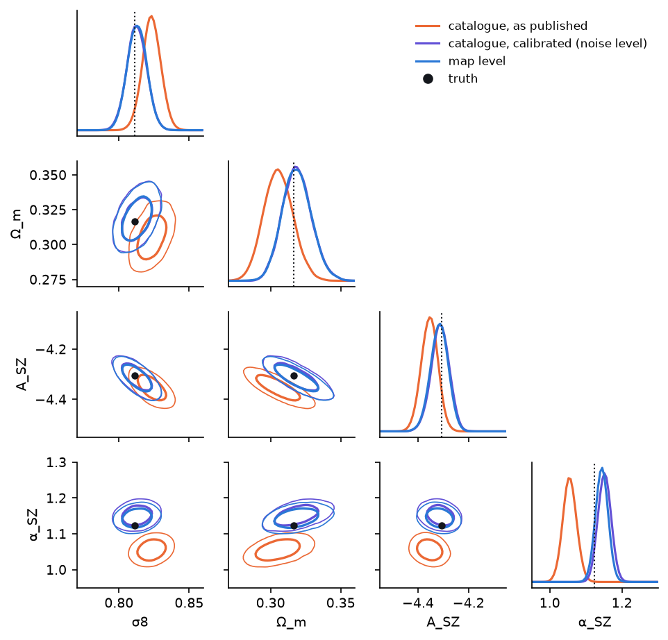

# Inference

## Neural posterior estimation

Each forward model gives simulations $(\boldsymbol\theta_n, \boldsymbol x_n)$ with $\boldsymbol\theta_n$
drawn from the prior and $\boldsymbol x_n$ the 21 numbers. Neural posterior estimation fits a conditional
density $q_\phi(\boldsymbol\theta\mid\boldsymbol x)$ by maximising

$$
\phi^\star = \arg\max_\phi \sum_n \ln q_\phi(\boldsymbol\theta_n \mid \boldsymbol x_n),
$$

which, with enough simulations and a flexible enough density, converges to the posterior of the model
that made the simulations. We follow the paper (`classy_szlite.sim.npe`): sbi's NPE with a masked
autoregressive flow of default size, one round, 10,000 simulations, learning rate $5\times10^{-4}$, stop
after 50 epochs without improvement.

The posterior is only right for data that its model describes. Applied to map-level data, a posterior
trained on catalogues answers the catalogue model's question; the tests below measure the consequence.

The first map-level mock, three posteriors (68% and 95% contours; $\Omega_m$ derived from $\omega_c$,
$\omega_b$ and $h$). The catalogue model as published puts $\sigma_8$ high and $\alpha_\mathrm{SZ}$ low;
calibrated through the noise level it is close to the map-level posterior. All three have similar widths:
map-level inference is not more precise on this summary, it is right.

## Checks

Every check uses simulations whose true parameters $\boldsymbol\theta^\star$ are known.

**Bias**, on 100 mocks at the true parameters:

$$
b = \frac{1}{100}\sum_m \frac{\mathrm E[\theta \mid \boldsymbol x_m] - \theta^\star}{\mathrm{sd}[\theta\mid\boldsymbol x_m]},
$$

with its error of the mean. A calibrated posterior has $b \approx 0$; with 100 mocks, biases down to about
0.1–0.2 posterior widths are resolved.

**Coverage**, on 500 draws from the prior: the fraction $C(\alpha)$ of draws whose true value lies in the
central credible interval of level $\alpha$, from the rank of the truth among 4,000 posterior samples. A
calibrated posterior has $C(\alpha) = \alpha$ at every level; below the diagonal it is overconfident.

**TARP** (Lemos et al. 2023), a test of the joint posterior in all ten parameters: the expected coverage
of balls around random reference points; its area to the diagonal is 0 for a calibrated posterior.

**Ensembles.** A single network's posterior mean moves by about 0.1 posterior widths from one training seed
to the next. Averaging five networks trained with different seeds (an equal mixture: mean of the means,
variance = mean variance + variance of the means) removes that scatter.

| Map-level posterior, 10% of the sky | $\sigma_8$ | $\omega_c$ | $A_\mathrm{SZ}$ | $\alpha_\mathrm{SZ}$ |
|---|---|---|---|---|
| bias, five networks (range) | −0.17 to +0.02 | +0.02 to +0.16 | −0.13 to +0.06 | +0.01 to +0.20 |
| bias, ensemble | −0.05 ± 0.10 | +0.10 ± 0.07 | −0.05 ± 0.09 | +0.08 ± 0.08 |
| bias, one network on 5,000 simulations | −0.05 | −0.01 | +0.02 | +0.16 |
| coverage at 50% / 90%, ensemble | 0.46 / 0.90 | 0.47 / 0.87 | 0.49 / 0.89 | 0.44 / 0.86 |

TARP areas are −0.009 to −0.029 for the individual networks. The $\alpha_\mathrm{SZ}$ intervals are slightly
narrow at 10% of the sky (86% at the 90% level) in every network and with half the simulations, so more
simulations would not fix it; at 40% of the sky they are right (88%).

## Cost

| Step | Hardware | Time |
|---|---|---|
| Training on 10,000 simulations | CPU, 2–16 threads | 2–8 min (160–470 epochs) |
| Bias on 100 mocks, 4,000 samples each | CPU | under 1 min |
| Coverage on 500 prior draws, 4,000 samples each | CPU | 1–15 min |
| The same for a strongly mismatched posterior | CPU | up to hours: sbi's rejection sampling discards samples outside the prior box |
| Five networks in parallel, 2 threads each | 16 cores | about 20 min |
