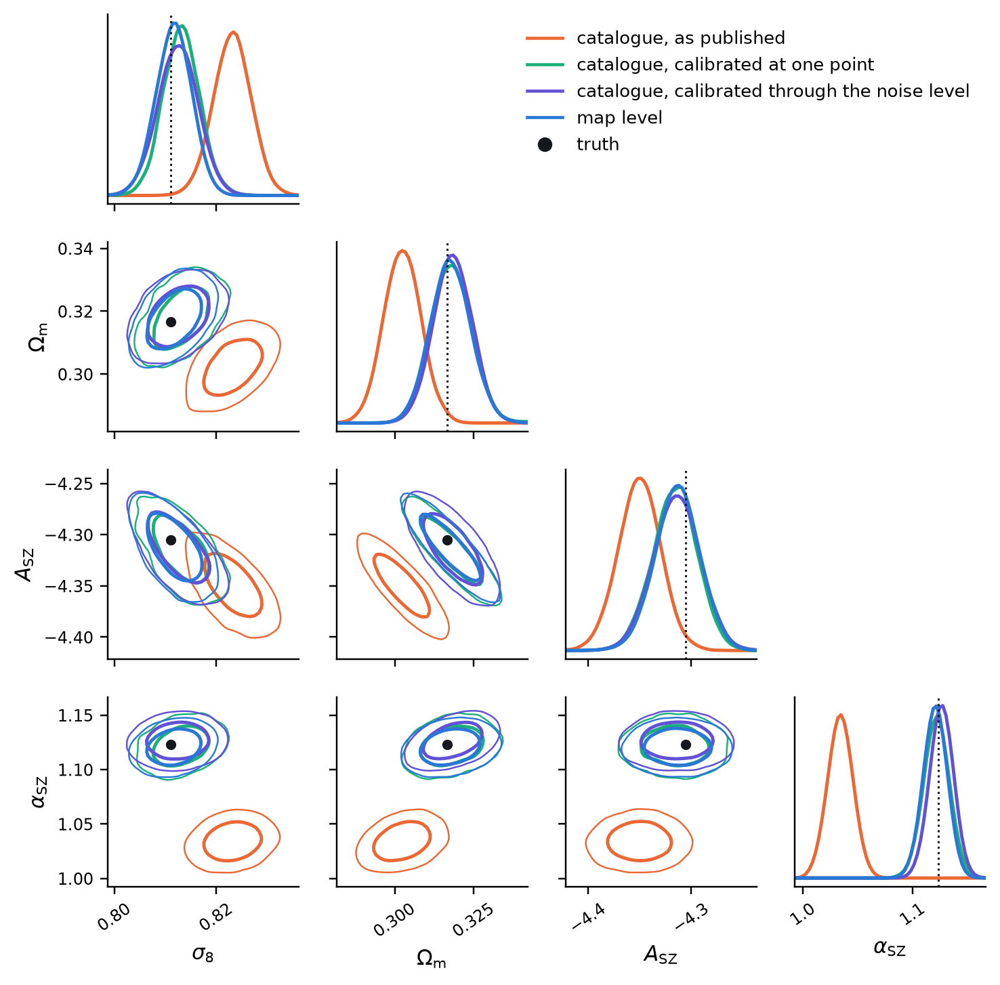

# Results

Four posteriors, each trained on 10,000 simulations of its own forward model from the same prior, all
applied to the same map-level skies. Public 2019 SO forecast noise, goal depth.

- **map level**: trained on map-level simulations, in which the finder runs on simulated maps;
- **calibrated at one point**: the catalogue model, the observation model of Zubeldia et al. (2025)
  ([Forward models](forward-models.md#the-catalogue-model)), with its observation calibrated on 20 map-level
  mocks at the true parameters;
- **calibrated through the noise level**: the same model calibrated at 25 points of the prior, written
  through the finder's noise level ([Calibration](calibration.md));
- **catalogue, uncalibrated**: the reference, the same model with a noise table for the instrument and the
  CMB only, as used in forecasts, with the table recomputed for our filter and noise.

## Bias at the true parameters

<figure markdown="span">
  
  <figcaption>The bias of each posterior on 100 map-level mocks at the true parameters: the mean of
  (posterior mean − truth) / posterior standard deviation, with its error of the mean (smaller than the
  symbols), for σ8, ω_c, A_SZ and α_SZ, at 10% (left) and 40.7% of the sky (right). Zero is unbiased; one
  is a shift of one posterior width.</figcaption>
</figure>

The map-level posterior (blue) is within 0.12 widths of the truth everywhere. At 40.7% of the sky its
largest departure is −0.11 ± 0.08 in $\sigma_8$ and its most significant +0.10 ± 0.04 in $\omega_c$.
Both calibrated models (green, violet) are within about 0.2 widths for $\sigma_8$, $\omega_c$ and
$A_\mathrm{SZ}$, but keep $\alpha_\mathrm{SZ}$ about 0.5–0.7 widths high at both sizes. The uncalibrated
reference (orange) is far off on these skies: $\sigma_8$ high and the slope $\alpha_\mathrm{SZ}$ very low,
and more so in the larger survey, where its posteriors are narrower ([Scope](#scope) says what this
depends on).

Mean over 100 mocks of (posterior mean − truth) / posterior standard deviation:

| 10% of the sky (41 tiles) | $\sigma_8$ | $\omega_c$ | $A_\mathrm{SZ}$ | $\alpha_\mathrm{SZ}$ |
|---|---|---|---|---|
| catalogue, uncalibrated | +1.86 ± 0.10 | −0.77 ± 0.06 | −1.42 ± 0.08 | −5.28 ± 0.11 |
| calibrated at one point | +0.13 ± 0.09 | +0.09 ± 0.06 | −0.06 ± 0.08 | +0.50 ± 0.08 |
| calibrated through the noise level | −0.07 ± 0.10 | +0.11 ± 0.06 | +0.09 ± 0.08 | +0.62 ± 0.09 |
| map level (5 networks) | −0.05 ± 0.10 | +0.10 ± 0.07 | −0.05 ± 0.08 | +0.08 ± 0.08 |

| 40.7% of the sky (168 tiles) | $\sigma_8$ | $\omega_c$ | $A_\mathrm{SZ}$ | $\alpha_\mathrm{SZ}$ |
|---|---|---|---|---|
| catalogue, uncalibrated (4 networks) | +2.85 ± 0.07 | −1.19 ± 0.04 | −1.74 ± 0.06 | −8.30 ± 0.07 |
| calibrated at one point (5) | +0.20 ± 0.08 | +0.17 ± 0.04 | −0.11 ± 0.06 | +0.52 ± 0.06 |
| calibrated through the noise level (5) | +0.05 ± 0.07 | +0.21 ± 0.04 | −0.03 ± 0.06 | +0.67 ± 0.07 |
| map level (5) | −0.11 ± 0.08 | +0.10 ± 0.04 | −0.05 ± 0.06 | +0.03 ± 0.06 |

The uncalibrated reference's bias grows with the survey by a factor of about 1.5. Its shift hardly changes with the
area (in $\sigma_8$ +0.0115 at 10% and +0.0103 at 40.7%; in $\alpha_\mathrm{SZ}$ −0.086 and −0.084), while the
posteriors get 1.3–1.7 times narrower, not 2 as four times the area would suggest. The shifts in $\sigma_8$ and $\Omega_m$
partly cancel in $S_8$ (−0.30 widths at 10%).

## The posterior at 40.7% of the sky

<figure markdown="span">
  { width="680" }
  <figcaption>The posteriors of the first map-level mock of the 168-tile survey (40.7% of the sky), in σ8,
  Ω_m, A_SZ and α_SZ: trained on map-level simulations (blue, five networks pooled), on the catalogue model
  calibrated at one point (green, one network), on the model calibrated through the noise level (violet, five
  networks pooled) and, as the reference, on the uncalibrated catalogue model (orange, one network). Contours: 68% and 95%; diagonal: the
  marginals; black: the true values.</figcaption>
</figure>

This is a survey of SO's size, on our skies at goal-depth forecast noise. With four times the area, every
posterior is 1.3–1.7 times narrower than at 10% of the sky. The map-level posterior contains the truth:
$\sigma_8 = 0.812 \pm 0.003$ against a true 0.811, and $\alpha_\mathrm{SZ} = 1.120 \pm 0.010$ against 1.123.
The two calibrated posteriors agree with it. On a single mock at the true parameters the calibrated models
look as good as map-level inference; where they differ is across the prior (next section) and in the
systematic $+0.5$–$0.7$ width shift of $\alpha_\mathrm{SZ}$ over 100 mocks (the table above), which one mock
cannot show.

The uncalibrated reference shows how large the finder's effects are at this depth ([Scope](#scope)). On this
mock it gives $\sigma_8 = 0.823 \pm 0.004$ (3.4 widths from the truth) and
$\alpha_\mathrm{SZ} = 1.034 \pm 0.011$ (8.3 widths), with $\Omega_m$ and $A_\mathrm{SZ}$ low: the degenerate
directions that let it explain too few bright clusters with a shallower mass slope.

## Coverage over the prior

<figure markdown="span">
  
  <figcaption>Coverage on 500 map-level skies drawn from the prior: the fraction of skies whose true value lies
  in the central credible interval, against the interval's level, for each of the four parameters, at 10%
  (top) and 40.7% of the sky (bottom). Dotted: the diagonal, where a posterior has correct coverage; below it, the
  intervals are too narrow or off-centre. At 10% of the sky the map-level curves are ensembles of five networks and every
  catalogue-model curve is one network; at 40.7% the map-level and noise-level curves are ensembles of five
  networks, the model calibrated at one point is one network, and the uncalibrated model was not run on these
  skies (its posteriors fall outside the prior box).</figcaption>
</figure>

A single bias at the true parameters can hide a posterior that is wrong elsewhere; coverage over the prior
tests every part of it. The map-level posterior (blue) follows the diagonal for all four parameters at both
sizes: at 40.7% of the sky its 90% intervals contain the truth for 0.88–0.91 of the skies and its 50%
intervals for 0.46–0.51. The model calibrated at one point (green) falls well below the diagonal for
$\sigma_8$ and $\omega_c$, and further at 40.7%: its intervals are too narrow or off-centre for skies away from its
calibration point (0.65 and 0.59 at 90% for $\sigma_8$). The calibrations that follow the parameters
(linear, dashed grey, 10% only; through the noise level, violet) bring $\sigma_8$, $\omega_c$ and
$A_\mathrm{SZ}$ close to the diagonal, but not $\alpha_\mathrm{SZ}$ (0.78 and 0.74 at 90% through the
noise level).

How often the central interval contains the true value, on 500 map-level skies drawn from the prior:

| 50% / 90% intervals | $\sigma_8$ | $\omega_c$ | $A_\mathrm{SZ}$ | $\alpha_\mathrm{SZ}$ |
|---|---|---|---|---|
| **10% of the sky** | | | | |
| calibrated at one point | 0.32 / 0.65 | 0.40 / 0.72 | 0.41 / 0.82 | 0.39 / 0.80 |
| calibrated, linear in the parameters | 0.42 / 0.84 | 0.46 / 0.86 | 0.47 / 0.88 | 0.41 / 0.79 |
| calibrated through the noise level | 0.46 / 0.90 | 0.47 / 0.89 | 0.48 / 0.88 | 0.42 / 0.78 |
| map level (5 networks) | 0.46 / 0.90 | 0.47 / 0.87 | 0.49 / 0.89 | 0.44 / 0.86 |
| **40.7% of the sky** | | | | |
| calibrated at one point (1 network) | 0.30 / 0.59 | 0.35 / 0.68 | 0.40 / 0.79 | 0.37 / 0.77 |
| calibrated through the noise level (5) | 0.50 / 0.86 | 0.51 / 0.90 | 0.52 / 0.90 | 0.35 / 0.74 |
| map level (5) | 0.51 / 0.90 | 0.47 / 0.88 | 0.48 / 0.91 | 0.46 / 0.88 |

## What this shows

1. Map-level inference works at SO scale. Its posterior is within 0.12 widths of the truth and has close to
   correct coverage over the prior at both sizes (its $\alpha_\mathrm{SZ}$ intervals are slightly narrow at
   10%, 0.86 at 90%), from a training set that takes 70 min (10% of the sky) or 4.6 h (40.7%) on one GPU.
   There is a possible small offset in $\omega_c$, +0.10 widths at both sizes, whose origin we have not
   determined (training or mocks).
2. A catalogue model calibrated on map-level mocks at one point is within about 0.2 widths in $\sigma_8$,
   $\omega_c$ and $A_\mathrm{SZ}$ there, with $\alpha_\mathrm{SZ}$ about half a width high, but its intervals
   are too narrow or off-centre across the prior, increasingly so as the survey grows.
3. Calibrated across the prior through the finder's noise level, it comes close to map-level inference for
   $\sigma_8$, $\omega_c$ and $A_\mathrm{SZ}$, at the cost of map-level simulations at 25 points; the slope
   $\alpha_\mathrm{SZ}$ stays 0.6–0.7 widths high and its intervals too narrow, because of an upward,
   tSZ-dependent tail in the finder's errors that a per-cluster model cannot carry.
4. The uncalibrated reference is off on our map-level skies by up to 5.3 widths at 10% of the sky and 8.3
   at 40.7%, at goal-depth forecast noise and with a flat prior on the slope ([Scope](#scope)). It leaves
   out the confusion noise of faint clusters, the finder's search over positions and sizes, and neighbours
   ([The finder](finder.md)), so it shows how large these effects are.

## Scope

The bias of the uncalibrated reference is measured in one set-up. Three of its choices set its size.

- **Noise level.** Every run uses goal-depth forecast noise, the deepest level of the 2019 SO forecast.
  Deeper noise brings more faint clusters close to the noise, so the confusion noise of faint halos and the
  search lift matter more. At higher instrument noise the confusion noise is a smaller part of the total
  (the two add in quadrature), and we expect the bias to be smaller; the model's counts should also come
  closer to the finder's than the 9–25% deficit above $q = 8.4$ seen here. We have not run other noise levels.
- **The noise in the model.** The uncalibrated model's noise is the instrument and the CMB only. Analyses of
  real data usually estimate the filter noise on the observed maps, which includes the confusion noise.
  Halo by halo, against the finder's own noise the scale $s$ is 0.990, against 0.921 for the
  instrument-plus-CMB noise: most of the offset is the noise ([The finder](finder.md)). The model calibrated
  at one point uses the finder's noise measured on map-level mocks; at the true parameters it is within
  0.2 widths in $\sigma_8$, $\omega_c$ and $A_\mathrm{SZ}$. What remains is a slope bias of about half a
  width (0.50 at 10% of the sky, 0.52 at 40.7%) and, across the prior, coverage that depends on how the
  calibration follows the parameters.
- **The prior on the slope.** The prior on $\alpha_\mathrm{SZ}$ is flat, U(1.00, 1.24). Most of the bias
  goes into the slope and its degeneracy with $\sigma_8$. Informative priors on the tSZ–mass relation, for
  example from weak-lensing mass calibration, would restrict this direction, and we expect them to reduce the bias. We have
  not tested this.

So this is about one uncalibrated model on our skies, not about catalogue-level analyses in general: a
catalogue model with the noise measured on the maps comes close to unbiased at the true parameters in our
tests, apart from the slope.

## Limitations

These tests compare two inferences on the same simulated skies, so the conclusions do not depend on how
realistic those skies are. A real-data analysis would need more:

- **Halo clustering.** Halos are placed at uniform random positions. Real clusters sit in overdense
  regions, so the projected signal of other halos, and the confusion noise, correlate with mass; the upward
  tail of the finder's errors is probably larger on the real sky. The simulator needs clustering before
  real data.
- **Noise.** The noise is Gaussian with one power spectrum per tile. Real maps have scan stripes, depth
  varying across the footprint and patchy atmosphere.
- **Foregrounds.** No CIB or radio sources. Both sit on clusters: radio galaxies fill in part of the
  decrement at low frequency, and the CIB adds emission at high frequency. A spectrally constrained filter
  removes most of the CIB's effect at some cost in signal-to-noise ([The finder](finder.md#how-it-differs-from-szifi));
  in a map-level simulator that paints the CIB, its effect would instead be part of the forward model.
- **Confirmation.** Detections are matched to simulated halos with exact redshifts; real catalogues rely
  on optical follow-up, with its own completeness, redshift errors and false matches.
- **Geometry.** Periodic flat tiles, no masks or survey edges.
- **The cluster model.** One pressure profile (Arnaud et al. 2010) and a fixed hydrostatic mass bias.
