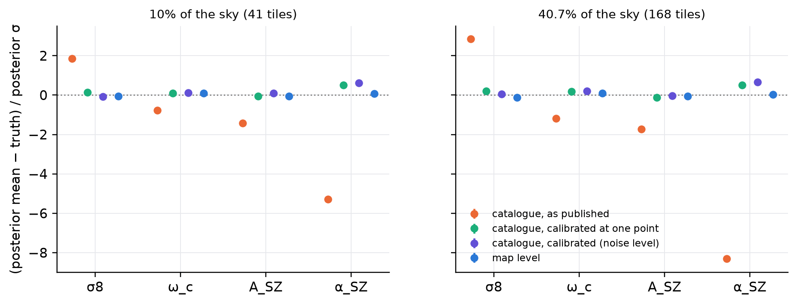
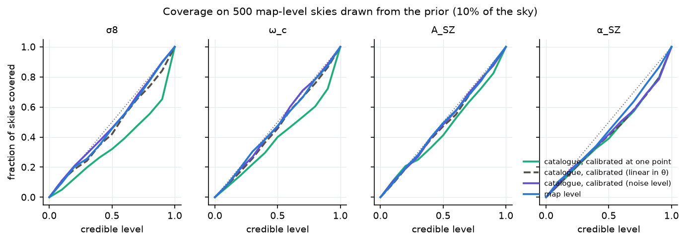

# Results

The bias test: four posteriors, each trained on 10,000 simulations of its own forward model from the same
prior, all applied to the same map-level skies. Public 2019 SO forecast noise, goal depth.

- **catalogue, as published**: the paper's catalogue model of this survey;
- **calibrated at one point**: its observation calibrated on 20 map-level mocks at the true parameters;
- **calibrated through the noise level**: calibrated at 25 points of the prior, written through the finder's
  noise level ([Calibration](calibration.md));
- **map level**: trained on map-level simulations.

## Bias at the true parameters

Mean over 100 mocks of (posterior mean − truth) / posterior standard deviation:

| 10% of the sky (41 tiles) | $\sigma_8$ | $\omega_c$ | $A_\mathrm{SZ}$ | $\alpha_\mathrm{SZ}$ |
|---|---|---|---|---|
| catalogue, as published | +1.86 ± 0.10 | −0.77 ± 0.06 | −1.42 ± 0.08 | −5.28 ± 0.11 |
| calibrated at one point | +0.13 ± 0.09 | +0.09 ± 0.06 | −0.06 ± 0.08 | +0.50 ± 0.08 |
| calibrated through the noise level | −0.07 ± 0.10 | +0.11 ± 0.06 | +0.09 ± 0.08 | +0.62 ± 0.09 |
| map level (5 networks) | −0.05 ± 0.10 | +0.10 ± 0.07 | −0.05 ± 0.08 | +0.08 ± 0.08 |

| 40.7% of the sky (168 tiles) | $\sigma_8$ | $\omega_c$ | $A_\mathrm{SZ}$ | $\alpha_\mathrm{SZ}$ |
|---|---|---|---|---|
| catalogue, as published (4 networks) | +2.85 ± 0.07 | −1.19 ± 0.04 | −1.74 ± 0.06 | −8.30 ± 0.07 |
| calibrated at one point (5) | +0.20 ± 0.08 | +0.17 ± 0.04 | −0.11 ± 0.06 | +0.52 ± 0.06 |
| calibrated through the noise level (5) | +0.05 ± 0.07 | +0.21 ± 0.04 | −0.03 ± 0.06 | +0.67 ± 0.07 |
| map level (5) | −0.11 ± 0.08 | +0.10 ± 0.04 | −0.05 ± 0.06 | +0.03 ± 0.06 |

The published model's bias grows with the survey by a factor of about 1.5 (posteriors narrow by less than
2, because the six Gaussian-prior parameters do not narrow). The shifts in $\sigma_8$ and $\Omega_m$
partly cancel in $S_8$ (−0.30 widths at 10%).

## Calibration over the prior

How often the central interval contains the true value, on 500 map-level skies drawn from the prior:

| 50% / 90% intervals | $\sigma_8$ | $\omega_c$ | $A_\mathrm{SZ}$ | $\alpha_\mathrm{SZ}$ |
|---|---|---|---|---|
| **10% of the sky** | | | | |
| calibrated at one point | 0.32 / 0.65 | 0.40 / 0.72 | 0.41 / 0.82 | 0.39 / 0.80 |
| calibrated, linear in the parameters | 0.42 / 0.84 | 0.46 / 0.86 | 0.47 / 0.88 | 0.41 / 0.79 |
| calibrated through the noise level | 0.46 / 0.90 | 0.47 / 0.89 | 0.48 / 0.88 | 0.42 / 0.78 |
| map level (5 networks) | 0.46 / 0.90 | 0.47 / 0.87 | 0.49 / 0.89 | 0.44 / 0.86 |
| **40.7% of the sky** | | | | |
| calibrated at one point (1 network) | 0.30 / 0.59 | 0.35 / 0.68 | 0.40 / 0.79 | 0.37 / 0.77 |
| calibrated through the noise level (5) | 0.50 / 0.86 | 0.51 / 0.90 | 0.52 / 0.90 | 0.35 / 0.74 |
| map level (5) | 0.51 / 0.90 | 0.47 / 0.88 | 0.48 / 0.91 | 0.46 / 0.88 |

## What this shows

1. The catalogue model as published is biased on map-level data, by up to 5.3 posterior widths at 10% of
   the sky and 8.3 at 40%. It leaves out the confusion noise of faint clusters, the finder's search over
   positions and sizes, and neighbours ([The finder](finder.md)).
2. Calibrated on map-level mocks at one point, it is nearly right there but miscalibrated across the prior,
   increasingly so as the survey grows.
3. Calibrated across the prior through the finder's noise level, it matches map-level inference for
   $\sigma_8$, $\omega_c$ and $A_\mathrm{SZ}$, at the cost of map-level simulations at 25 points; the slope
   $\alpha_\mathrm{SZ}$ stays biased by about 0.6 widths and overconfident, because of an upward,
   tSZ-dependent tail in the finder's errors that a per-cluster model cannot carry.
4. Map-level inference is unbiased to 0.1 widths and calibrated over the prior at both survey sizes. A
   possible small offset in $\omega_c$, +0.10 widths at both sizes, is still to be checked.

## Limitations

These tests compare two inferences on the same simulated skies, so the conclusions do not depend on how
realistic those skies are. A real-data analysis would need more:

- **Halo clustering.** Halos are placed at uniform random positions. Real clusters sit in overdense
  regions, so the projected signal of other halos, and the confusion noise, correlate with mass; the upward
  tail of the finder's errors is probably larger on the real sky, which would strengthen the case against
  catalogue models. The simulator needs clustering before real data.
- **Noise.** The noise is Gaussian with one power spectrum per tile. Real maps have scan stripes, depth
  varying across the footprint and patchy atmosphere.
- **Foregrounds.** No CIB or radio sources, which matter most at high frequency.
- **Confirmation.** Detections are matched to simulated halos with exact redshifts; real catalogues rely
  on optical follow-up, with its own completeness, redshift errors and false matches.
- **Geometry.** Periodic flat tiles, no masks or survey edges.
- **The cluster model.** One pressure profile (Arnaud et al. 2010) and a fixed hydrostatic mass bias.
