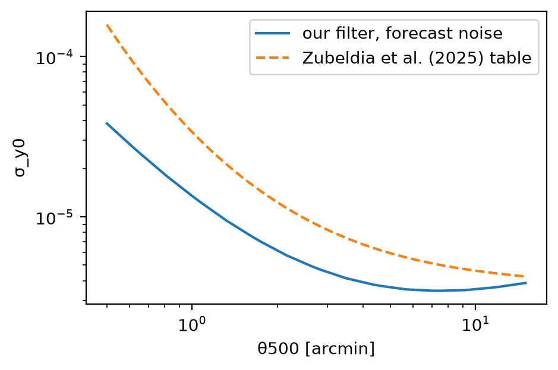
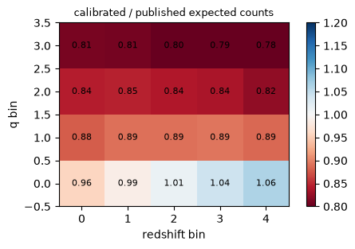

# Catalogue models

The catalogue-level model of Zubeldia et al. (2025) for the 41-tile survey (10% of the sky), as published and
calibrated on map-level simulations. Runs on a laptop CPU in a few minutes.


```python
import time
import numpy as np
import matplotlib.pyplot as plt
import jax
jax.config.update("jax_enable_x64", True)
from classy_szlite.sim import survey, catalogue as ct, priors, summaries as sm

sz, le, cfg = survey.catalogue_model("published", n_tiles=41)
cells = ct.survey_cells()
th = priors.to_theta(priors.fiducial())
print(f"f_sky = {cfg.f_sky:.4f}")
```

    f_sky = 0.0994


## The noise table

The published model's $q$ is $\bar y_0 / \sigma_{y_0}(\theta_{500})$, with $\sigma_{y_0}$ the matched
filter's noise for the instrument and the CMB: here computed analytically for our filter and the 2019 SO
forecast noise. The paper's own table (for its filter and 40% of the sky) is shown for comparison.


```python
import jax.numpy as jnp
paper_sz, _ = ct.paper_tables()
tt = np.geomspace(0.5, 15, 50)
plt.figure(figsize=(5, 3.2))
plt.loglog(tt, np.asarray(ct.noise_sigma(sz, jnp.asarray(tt))), label="our filter, forecast noise")
plt.loglog(tt, np.asarray(ct.noise_sigma(paper_sz, jnp.asarray(tt))), "--", label="the paper's table")
plt.xlabel("θ500 [arcmin]"); plt.ylabel("σ_y0"); plt.legend()
```


    <matplotlib.legend.Legend at 0x114c9b4d0>


    

    


## Expected counts and simulations

`catalogue.expected` integrates the model; `catalogue.simulate` draws catalogues (the halos, their scatter and
noise). The two agree.


```python
ec, en, ep = jax.jit(lambda t: ct.expected(t, cells, sz, le, cfg))(th)
sim = jax.jit(lambda k: ct.simulate(k, th, cells, sz, le, cfg))
t0 = time.time()
cats = [sim(jax.random.key(i)) for i in range(20)]
print(f"20 catalogues in {time.time() - t0:.1f} s (including compilation)")
C = np.array([np.asarray(c.counts) for c in cats])
print("expected counts (rows: q 5-8.4, 8.4-14, 14-24, 24-40; columns: z bins of 0.3):")
print(np.round(np.asarray(ec)).astype(int))
print(f"selected (q > 5): expected {float(en):.0f}, simulated {np.mean([int(c.n_sel) for c in cats]):.0f}; mean p {float(ep / en):.4f}")
```

    20 catalogues in 2.7 s (including compilation)


    expected counts (rows: q 5-8.4, 8.4-14, 14-24, 24-40; columns: z bins of 0.3):
    [[1267 2930 2515 1488  716]
     [ 560 1230  940  483  200]
     [ 223  468  316  140   49]
     [  74  149   88   33   10]]
    selected (q > 5): expected 14570, simulated 14569; mean p 0.2500


## Calibrated on map-level simulations

A calibration replaces the instrument-plus-CMB noise by the finder's own noise and, per redshift bin, draws
$q_\mathrm{obs} = \sqrt{(s q)^2 + k} + w\,\mathcal N(0,1)$, with a loss rate $f$. Here the values measured on 20
map-level mocks at the true parameters (the table on the Calibration page), with the finder's noise 7.6% above
the analytic one at 2′ (and the measured ratio at each filter size).


```python
# the finder's noise over the analytic one at the filter's 15 sizes (0.5' to 15'), mean over 41 tiles x 5 mocks
ratio = np.array([1.059, 1.062, 1.064, 1.067, 1.070, 1.073, 1.075, 1.076, 1.076, 1.074, 1.070, 1.064, 1.056, 1.047, 1.038])
sz_cal = sz._replace(lnsig=sz.lnsig + np.log(ratio)[None])
qcal = ((0.31, 0.991, 1.32, 1.035, 0.029), (0.61, 0.989, 1.51, 1.043, 0.013), (0.90, 0.988, 1.50, 1.079, 0.006),
        (1.20, 0.991, 1.29, 1.132, 0.003), (1.50, 0.990, 1.07, 1.177, 0.002), (99.0, 1.002, 0.07, 1.317, 0.0))
cfg_cal = cfg._replace(qcal=qcal)
ec_cal, en_cal, _ = jax.jit(lambda t: ct.expected(t, cells, sz_cal, le, cfg_cal))(th)
r = np.asarray(ec_cal) / np.asarray(ec)
plt.figure(figsize=(5.5, 3))
plt.imshow(r, cmap="RdBu", vmin=0.8, vmax=1.2, origin="lower")
for i in range(4):
    for j in range(5):
        plt.text(j, i, f"{r[i, j]:.2f}", ha="center", va="center", fontsize=8)
plt.xlabel("redshift bin"); plt.ylabel("q bin"); plt.title("calibrated / published expected counts", fontsize=9); plt.colorbar()
print(f"selected: published {float(en):.0f}, calibrated {float(en_cal):.0f}")
```

    selected: published 14570, calibrated 13993


    

    


---

*Generated from [`examples/notebooks/catalogue_models.ipynb`](https://github.com/CLASS-SZ/classy_szlite/blob/mapsim/examples/notebooks/catalogue_models.ipynb), executed on an Apple M1 Pro laptop.*
