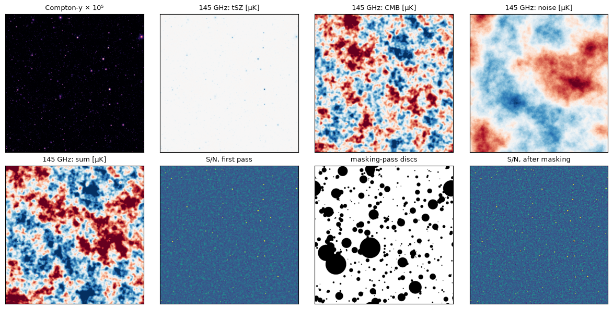
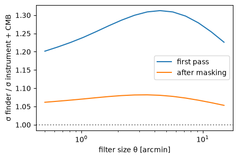
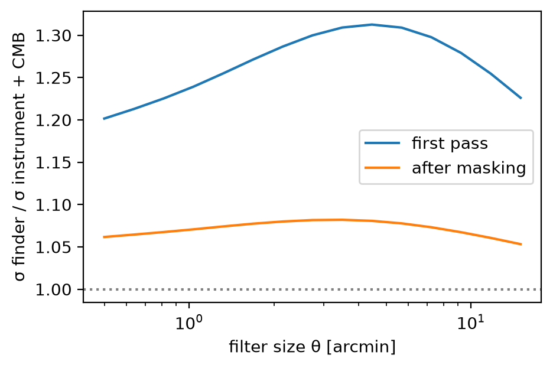

# One tile, stage by stage

One 10° × 10° tile of the survey at the true parameters, through every stage of the map-level simulator
and the cluster finder, with the public 2019 SO forecast noise. Runs on a laptop CPU: about 1 min the first
time (the paint tables are built and cached, the code is compiled), a few seconds after; about 3.5 GB of
memory.


```python
import time
import numpy as np
import matplotlib.pyplot as plt
import jax
jax.config.update("jax_enable_x64", True)
from classy_szlite.sim import tile, priors

t0 = time.time()
o = tile.stages()          # the first tile of the first mock of the published 'truth' set
print(f"{time.time() - t0:.0f} s")
```

    19 s


## The maps

`o` holds the Compton-y map, the 145 GHz map and its three parts, and the finder's signal-to-noise before
and after its masking pass, each 1200 × 1200 pixels of 0.5′.


```python
down = lambda a: a.reshape(600, 2, 600, 2).mean((1, 3))
panels = [("y", "Compton-y × 10⁵", "magma", 0, 3), ("tsz145", "145 GHz: tSZ [μK]", "RdBu_r", -200, 200),
          ("cmb145", "145 GHz: CMB [μK]", "RdBu_r", -200, 200), ("noise145", "145 GHz: noise [μK]", "RdBu_r", -200, 200),
          ("m145", "145 GHz: sum [μK]", "RdBu_r", -200, 200), ("q_first", "S/N, first pass", "viridis", -3, 8),
          ("mask", "masking-pass discs", "gray", 0, 1), ("q_final", "S/N, after masking", "viridis", -3, 8)]
fig, ax = plt.subplots(2, 4, figsize=(12, 6))
for a, (k, t, cm, lo, hi) in zip(ax.ravel(), panels):
    m = o[k] * (1e5 if k == "y" else 1)
    a.imshow(down(m), cmap=cm, vmin=lo, vmax=hi, origin="lower", extent=[0, 10, 0, 10])
    a.set_title(t, fontsize=9); a.set_xticks([]); a.set_yticks([])
plt.tight_layout()
```


    

    


## The catalogue

Halos above $5\times10^{13}\,M_\odot$, and the finder's kept peaks with $q > 4$; a peak is confirmed if
a halo above that mass lies within 1.5′.


```python
p, h = o["peaks"], o["halos"]
det = p["confirmed"] & (p["q"] > 5)
print(f"halos above 5e13 Msun: {len(h['z'])}")
print(f"kept peaks with q > 4: {len(p['q'])}; confirmed with q > 5: {det.sum()}; not confirmed with q > 5: {np.sum(~p['confirmed'] & (p['q'] > 5))}")
order = np.argsort(-p["q"])[:8]
print("brightest detections: q, size [arcmin], the halo's z, M500 [Msun] and catalogue-model q")
for i in order:
    j = p["halo"][i]
    print(f"  {p['q'][i]:6.1f}  {p['size'][i]:4.1f}'  " + (f"z {h['z'][j]:.2f}  M {h['M500'][j]:.1e}  q_model {h['q_model'][j]:.1f}" if j >= 0 else "no halo"))
```

    halos above 5e13 Msun: 4292
    kept peaks with q > 4: 566; confirmed with q > 5: 324; not confirmed with q > 5: 0
    brightest detections: q, size [arcmin], the halo's z, M500 [Msun] and catalogue-model q
        72.5   3.5'  z 0.48  M 1.1e+15  q_model 78.8
        53.4   2.7'  z 0.63  M 6.8e+14  q_model 57.3
        47.0   4.5'  z 0.33  M 8.1e+14  q_model 50.9
        38.6   2.7'  z 0.50  M 6.7e+14  q_model 40.7
        35.2   2.1'  z 0.54  M 6.4e+14  q_model 38.6
        32.0   1.3'  z 1.11  M 5.5e+14  q_model 36.2
        30.4   4.5'  z 0.31  M 7.7e+14  q_model 32.2
        29.8   2.7'  z 0.56  M 6.1e+14  q_model 35.2


## The finder's noise

The finder estimates its noise from the maps, which contain the tSZ of every cluster. Before masking, the
bright clusters raise it by 20–30%; after masking, the faint ones still add 4–8% over the instrument and the
CMB: the confusion noise that the catalogue model leaves out.


```python
th = o["thetas"]
plt.figure(figsize=(5, 3.2))
plt.plot(th, o["sigma_first"] / o["sigma_model"], label="first pass")
plt.plot(th, o["sigma_final"] / o["sigma_model"], label="after masking")
plt.axhline(1, color="gray", ls=":")
plt.xscale("log"); plt.xlabel("filter size θ [arcmin]"); plt.ylabel("σ finder / σ instrument + CMB"); plt.legend()
print("after masking, at 2': ", round(float(o["sigma_final"][7] / o["sigma_model"][7]), 3))
```

    after masking, at 2':  1.082


    

    


## Detected q against the catalogue model's q

For every confirmed detection, the finder's $q$ against the catalogue model's $q$ of its halo. Above
$q \approx 6$ the finder's is lower (its noise is higher); near the threshold the search over positions and
sizes lifts it.


```python
qm = h["q_model"][p["halo"][p["confirmed"]]]
qo = p["q"][p["confirmed"]]
plt.figure(figsize=(4.2, 4))
plt.loglog(qm, qo, ".", ms=3, alpha=0.6)
plt.plot([3, 80], [3, 80], "k--", lw=1, label="catalogue model: q_obs = q")
plt.xlim(3, 80); plt.ylim(4, 80); plt.xlabel("catalogue model's q"); plt.ylabel("finder's q"); plt.legend()
```


    <matplotlib.legend.Legend at 0x115610380>


    

    


---

*Generated from [`examples/notebooks/one_tile.ipynb`](https://github.com/CLASS-SZ/classy_szlite/blob/mapsim/examples/notebooks/one_tile.ipynb), executed on an Apple M1 Pro laptop.*
